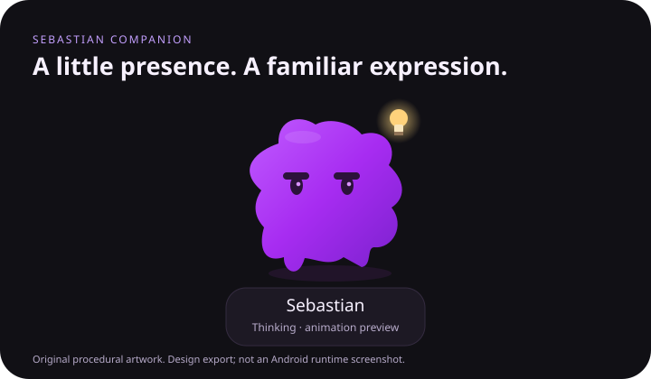

# Sebastian Companion

An independent native Android companion prototype: a purple animated character, a home-screen widget, and a shortcut to ChatGPT. **This is not the current Codex/ChatGPT assistant running on your phone.**



*Design export of the procedural artwork, not a runtime screenshot.*

## Available in v0.1

- Original procedural purple character, with idle breathing, blinking, thinking/lightbulb, speaking, happy, and resting expressions.
- Dark companion screen, reduced motion, and animation paused when the activity is not visible.
- Bounded, resizable 2×2 home-screen widget. The widget renders a still character; continuous animation runs in the app only.
- Tap the character or widget to open the installed ChatGPT app. If absent, open ChatGPT on the web.
- Optional private `https://chatgpt.com/c/…` conversation URL stored locally. Android chooses the app or browser using its normal link handling. Exact dot conversation routing is **unverified**, and this app does not generate a dot deep link.
- User-triggered speech preview using an available offline Android English voice. The voice is not ChatGPT's voice.
- Manual JSON status snapshot import through Android's document picker, with strict size/freshness validation. Imported status is always labelled as a snapshot; expressions selected in the app are labelled as previews.
- No Internet, microphone, notification, overlay, accessibility, usage access, storage, or background service permissions. No analytics, account scraping, API keys, or session extraction.

## Build

Requires JDK 17, Android SDK platform 36, and Android SDK Build Tools (Gradle selects the appropriate version). Android 12/API 31 or newer is supported, including Pixel 8 Pro.

```sh
./gradlew testDebugUnitTest lintDebug assembleDebug
```

Set `ANDROID_HOME` to your Android SDK or create an untracked `local.properties` containing `sdk.dir=/your/android/sdk`. Output: `app/build/outputs/apk/debug/app-debug.apk`. The debug APK is for development, not a Play Store release. CI uploads it as a workflow artifact.

Install the APK yourself on a test device. Add the widget from the in-app button (the launcher asks for confirmation), or long-press the home screen → Widgets → Sebastian. No physical device installation is performed by the project setup.

## Integration boundaries

| Requested capability | Current status |
| --- | --- |
| Character presence inside the app | Implemented, original procedural interpretation |
| Home-screen character | Implemented as a bounded widget with still rendering |
| Exact original sprites/animations | Not available; no private product assets bundled |
| Exact current model, memories, persona runtime | Not connected; no claim of identity or session continuity |
| Real live assistant status updates | Not connected; `StatusSource` is the adapter boundary |
| Speech | Offline Android voice preview only |
| Open ChatGPT app | Android package launch with web fallback |
| Open exact dot conversation | Unverified; optional user-supplied conversation URL only |
| Roam freely on the home screen | Not implemented; normal widgets are bounded |

An overlay would need special user-granted permission and would normally appear over other apps too. Home-only detection would require additional integration or intrusive signals; this project does not collect those signals or replace Pixel Launcher.

`StatusSource` and `StatusSnapshot` are transport-neutral so a future documented, authorized backend can supply events. The provided `SnapshotStore` imports user-selected local files. It has no automatic polling, server, or connection to private desktop state. Snapshots expire after five minutes in the app. Widgets display the snapshot's timestamp and expression as historical data; Android's periodic widget refresh is not an exact timer. A historical snapshot must never be presented as live assistant activity.

The official [Codex App Server documentation](https://learn.chatgpt.com/docs/app-server) describes a supported integration for a client-owned Codex runtime with streamed agent events. That is a possible future adapter; it does not by itself establish access to this ChatGPT dot conversation or export its assets, memory, or voice. The existing desktop app tools can read thread summaries within an authorized agent task, but are not a documented general Android subscription API.

Android's [widget overview](https://developer.android.com/develop/ui/views/appwidgets/overview) explains bounded home-screen surfaces. App launch uses Android's documented [PackageManager API](https://developer.android.com/reference/android/content/pm/PackageManager#getLaunchIntentForPackage(java.lang.String)). No undocumented ChatGPT URL schemes are used.

## Status snapshot contract

Supply UTF-8 JSON under 16 KB. `updatedAt` is a Unix timestamp in milliseconds, no older than five minutes and not in the future. `message` is at most 280 characters. Allowed states: `IDLE`, `THINKING`, `SPEAKING`, `HAPPY`, `RESTING`. Imported text is not automatically spoken.

```json
{
  "schemaVersion": 1,
  "state": "THINKING",
  "message": "An update supplied by your chosen source",
  "updatedAt": 1800000000000
}
```

Replace the example timestamp with the current time before importing. The file's content is user supplied, not authenticated by this app. Do not include secrets or private conversation content in a public repository. Conversation URLs and snapshots stay in private app storage; backup is disabled. Clear an imported snapshot in Connection, clear the link via “Use app home,” or clear all data through Android app settings.

## Development

Native Java and Android Canvas, no third-party runtime dependencies. `PetRenderer` shares original artwork between the animated app view and static widget. `ConversationLink` strictly limits saved URLs to HTTPS ChatGPT conversation paths. `CompanionContractTest` exercises link safety, freshness boundaries, and invalid snapshots. Build/test verification is recorded in [docs/verification.md](docs/verification.md).

This project is independent and is not affiliated with or endorsed by OpenAI. ChatGPT and Codex are their respective owners' marks. The original source and artwork in this repository are MIT licensed. No reference screenshot, private conversation, product sprite sheet, credentials, or device identifiers are included.
